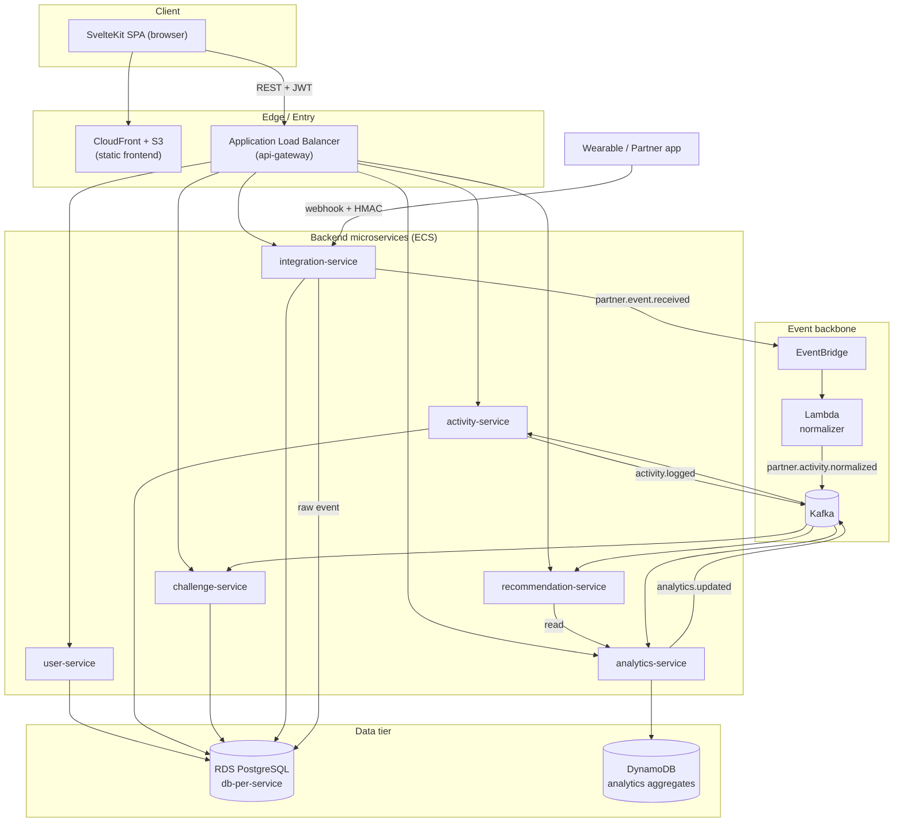
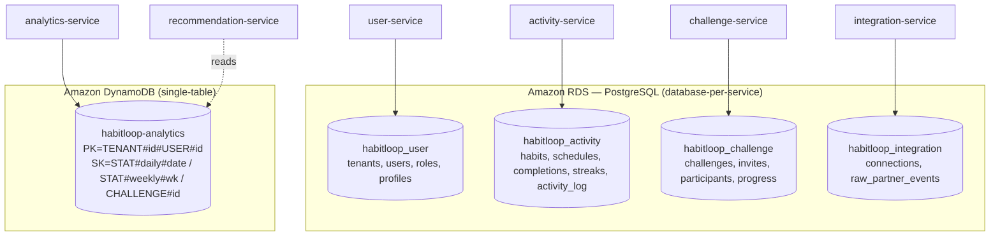
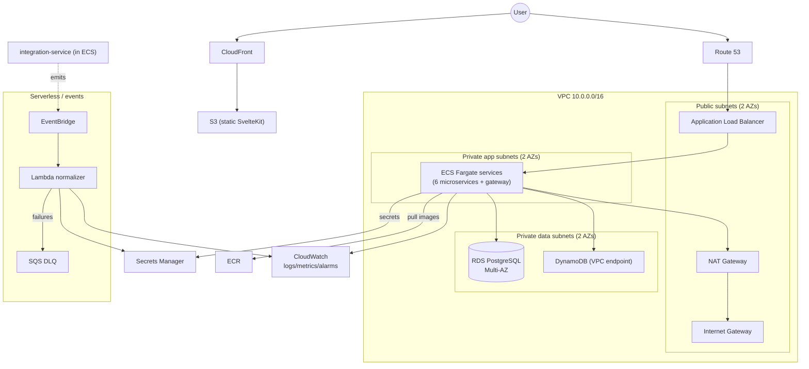
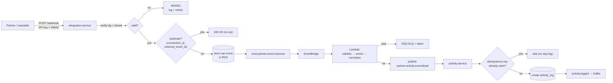
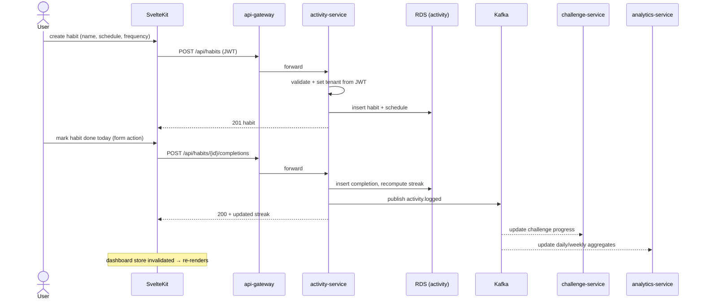
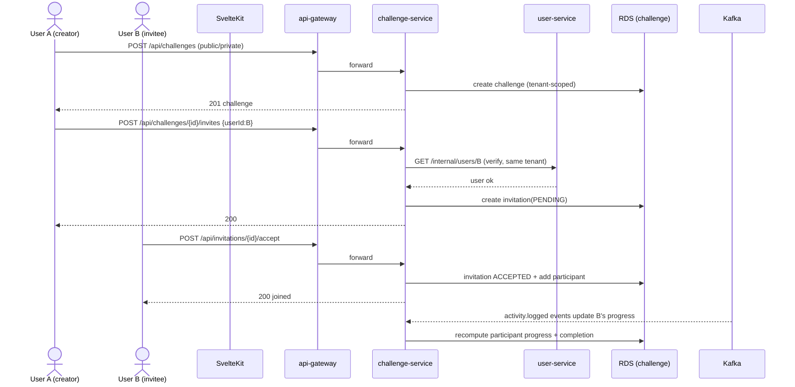
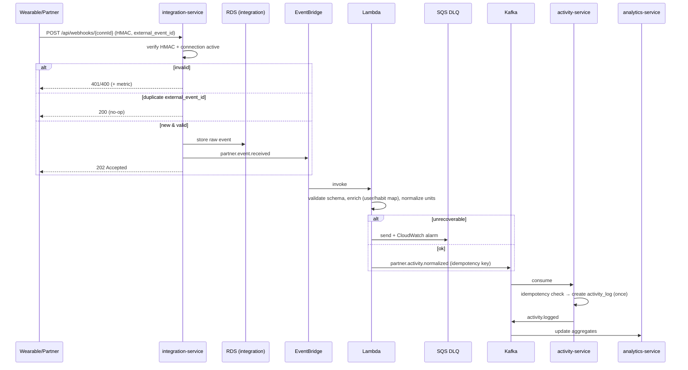

# 03 — Architecture Diagrams (Mermaid)

All ten required diagrams, each followed by a plain-language explanation. These render on GitHub and in
any Mermaid-aware viewer.

> **Revision note.** A few diagrams below show the frontend as an SSR app with `hooks.server.ts` + httpOnly
> cookies and an API gateway. The implementation was revised to match the Session 3 brief: the frontend is a
> **static SPA on Amazon S3** (client-side JWT, CORS to the backend), and routing is done by the **ALB**
> (no standalone gateway). The network topology is in
> [diagrams/network-architecture.drawio](diagrams/network-architecture.drawio); see
> [06-aws-infrastructure.md](06-aws-infrastructure.md) and `frontend/README.md`.

---

## 1. Overall system architecture



**Explanation.** The browser loads the static SvelteKit app from CloudFront/S3 and talks to the backend
through the ALB, which routes to the API gateway and on to the six services. Transactional data lives in
RDS (one logical database per service); aggregated analytics live in DynamoDB. The event backbone is the
spine: Activity Service publishes `activity.logged`, which both Challenge and Analytics react to; a
wearable's webhook enters Integration Service, is stored raw in RDS, then flows EventBridge → Lambda →
normalized event → Activity Service, which creates the real activity log.

---

## 2. Microservices architecture (internal layering & ownership)

```mermaid
flowchart LR
    GW["api-gateway<br/>(Spring Cloud Gateway)<br/>JWT verify + route"]

    subgraph US["user-service"]
        USc["controller"] --> USs["service"] --> USr["repository"] --> USdb[("habitloop_user")]
    end
    subgraph AS["activity-service"]
        ASc["controller"] --> ASs["service"] --> ASr["repository"] --> ASdb[("habitloop_activity")]
    end
    subgraph CS["challenge-service"]
        CSc["controller"] --> CSs["service"] --> CSr["repository"] --> CSdb[("habitloop_challenge")]
    end
    subgraph IS["integration-service"]
        ISc["controller"] --> ISs["service"] --> ISr["repository"] --> ISdb[("habitloop_integration")]
    end
    subgraph ANS["analytics-service"]
        ANSc["controller"] --> ANSs["service"] --> ANSr["repository"] --> ANSdb[("DynamoDB")]
    end
    subgraph RS["recommendation-service"]
        RSc["controller"] --> RSs["service (heuristics)"]
    end

    GW --> USc & ASc & CSc & ISc & ANSc & RSc
    RSs -->|read aggregates| ANSc
    CSs -. consumes activity.logged .-> AS
```

**Explanation.** Every service repeats the same clean layering — controller (HTTP/DTO), service (domain
logic + tenant checks), repository (persistence) — and owns its own database. The gateway is the single
front door. Recommendation Service is special: no database of its own, it reads analytics aggregates and
derives recommendations. The dashed line shows Challenge Service learning about progress by consuming
events rather than calling Activity Service synchronously.

---

## 3. Frontend-to-backend communication

```mermaid
flowchart TB
    subgraph FE["SvelteKit frontend"]
        R["Routes (pages)"]
        Runes["Svelte 5 Runes stores<br/>(auth, habits, challenges)"]
        Stencil["Stencil web components<br/>(chart, progress, tiles)"]
        Actions["Form actions<br/>(create activity, accept invite, connect)"]
        Hooks["hooks.server.ts<br/>(JWT cookie, guards)"]
        APIc["Typed API client"]
    end

    GW["api-gateway"]

    R --> Runes
    R --> Stencil
    R --> Actions
    Actions --> Hooks
    R -->|load()| Hooks
    Hooks --> APIc
    APIc -->|"HTTPS + Bearer JWT"| GW
    GW -->|JSON| APIc
    APIc --> Runes
    Runes --> R
```

**Explanation.** Pages read reactive state from Runes stores and render Stencil components for charts/progress.
Writes go through SvelteKit **form actions**, which run on the server side (`hooks.server.ts`) where the
JWT lives in an httpOnly cookie. The server-side typed API client calls the gateway with a Bearer token;
responses update the Runes stores, which re-render the pages. This keeps the token off the client JS and
gives progressive-enhancement forms.

---

## 4. Database architecture



**Explanation.** Each service has an isolated logical database in RDS — no shared tables, no cross-service
foreign keys (references across services are by id only, validated via events/APIs). Every tenant-owned
table carries a `tenant_id` column. DynamoDB holds **only** aggregated analytics using a single-table
design: the partition key scopes to tenant+user and the sort key distinguishes daily stats, weekly stats,
and per-challenge rollups, giving O(1) reads for the dashboard.

---

## 5. AWS infrastructure architecture



**Explanation.** A VPC with three subnet tiers across two AZs: public (ALB, NAT, IGW), private-app
(ECS Fargate running the services — no public IPs), and private-data (RDS Multi-AZ; DynamoDB reached via a
VPC endpoint so traffic never leaves AWS). Images come from ECR, secrets from Secrets Manager. The static
frontend is served globally by CloudFront in front of S3. Partner events emitted by Integration Service go
to EventBridge → Lambda, with an SQS dead-letter queue for failures. Everything logs and alarms to
CloudWatch.

---

## 6. External integration event flow



**Explanation.** A partner POSTs an event with an API key and an HMAC signature. Integration Service
verifies the signature and tenant, drops invalid payloads, and short-circuits duplicates by a unique
`(connection_id, external_event_id)`. Valid new events are stored raw in RDS and emitted to EventBridge.
Lambda validates/enriches/normalizes; unrecoverable events go to a DLQ with an alarm. Good events become
`partner.activity.normalized`, consumed by Activity Service, which applies a **second** idempotency check
before writing the activity log — so even a replayed event never creates a duplicate.

---

## 7. User registration & authentication (sequence)

```mermaid
sequenceDiagram
    actor U as User
    participant FE as SvelteKit
    participant GW as api-gateway
    participant US as user-service
    participant DB as RDS (user)
    participant K as Kafka

    U->>FE: fill registration form
    FE->>GW: POST /api/auth/register
    GW->>US: forward
    US->>US: validate, hash password (BCrypt)
    US->>DB: create tenant (if new) + user + role
    US->>K: publish user.registered
    US-->>FE: 201 Created
    U->>FE: login (email, password)
    FE->>GW: POST /api/auth/login
    GW->>US: forward
    US->>DB: load user, verify BCrypt hash
    US-->>FE: 200 + JWT (tenantId, userId, roles)
    FE->>FE: store JWT in httpOnly cookie
    Note over FE,GW: subsequent calls send Bearer JWT;<br/>gateway verifies before routing
```

**Explanation.** Registration validates input, hashes the password with BCrypt, creates the tenant (if the
user is the first) plus the user and role, and announces `user.registered`. Login verifies the hash and
returns a JWT carrying `tenantId`, `userId`, and roles. The frontend keeps the token in an httpOnly cookie;
every later request carries it as a Bearer token that the gateway verifies before routing.

---

## 8. Habit creation & activity tracking (sequence)



**Explanation.** Creating a habit validates the payload, stamps the tenant from the JWT, and persists the
habit plus its schedule. Recording a completion inserts the row, recomputes the streak in the user's
timezone, and publishes `activity.logged`. Challenge Service and Analytics Service both consume that event
to update progress and aggregates asynchronously, so the write path stays fast. The frontend invalidates
the dashboard store so it re-renders with the new streak.

---

## 9. Challenge participation (sequence)



**Explanation.** The creator makes a challenge (public or private, scoped to the tenant). Inviting a user
triggers a read-only, same-tenant verification call to User Service (timeout + circuit breaker). The
invitee accepts, becoming a participant. From then on, Challenge Service updates each participant's progress
by **consuming** `activity.logged` events — no synchronous polling — and recomputes completion against the
challenge's target.

---

## 10. Wearable integration event-processing (sequence)



**Explanation.** This is the full event pipeline and the heart of the brief's end-to-end workflow. The
partner's webhook is authenticated by HMAC and de-duplicated at the edge. Valid events are persisted raw
and handed to EventBridge → Lambda, which does the real work of validation, enrichment (mapping the partner
event to a HabitLoop user/habit), and unit normalization. Failures land in a DLQ with an alarm; successes
become a normalized event that Activity Service turns into exactly one activity log (idempotency key),
which then feeds analytics — closing the loop from device to dashboard.
